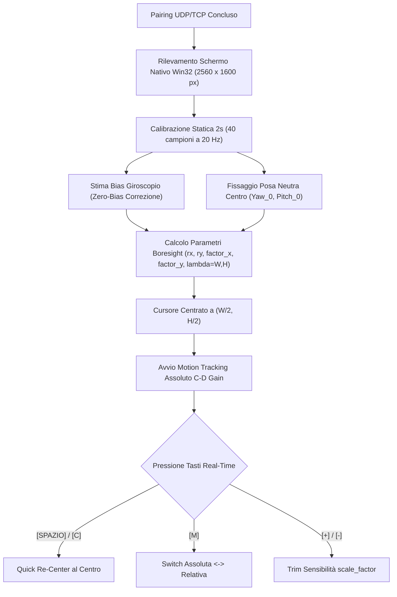

# Specifiche di Sviluppo: Progetto "AntiGravity" (Smartwatch come Mouse)

## 1. Contesto e Base di Partenza
Il progetto "AntiGravity" trasforma uno smartwatch Wear OS in un mouse a mezz'aria basandosi sui principi dell'architettura *Magic-Hand* (Bi et al., 2021).
L'architettura definitiva adotta un modello distribuito:
*   Lo **Smartwatch (Wear OS)** agisce puramente da unità di acquisizione sensoriale (*Sensing Unit*): legge i dati, applica il de-noising Wavelet e li trasmette via UDP.
*   Il **PC (Script Python)** riceve il flusso dei sensori, esegue il calcolo dell'assetto 3D tramite filtro AHRS, gestisce la macchina a stati per l'Anti-Jumping, calcola la cinematica e controlla il cursore del mouse.

Componenti software correnti:
*   `MainActivity.kt`: UI minimale su Wear OS in Jetpack Compose (stato di connessione e toggle Start/Stop, display sempre attivo, nessun rendering di angoli/coordinate).
*   `WaveletDenoiser.kt`: Denoising con trasformata Wavelet (db4, finestra da 64 campioni, ritardo intrinseco di 4 campioni) per ripulire i segnali IMU.
*   `SensorStreamer.kt`: Raccoglie i dati dei sensori a $20\text{ Hz}$, applica il `WaveletDenoiser` e trasmette i pacchetti UDP in formato JSON verso il PC (contiene vettori puliti `acc`, `gyro`, `mag` e dati grezzi `raw`).
*   `ahrs.py`: Modulo Python contenente l'implementazione del filtro AHRS di Madgwick (supporto 6-DOF IMU e 9-DOF MARG) per la stima dell'orientamento e il calcolo degli angoli di Eulero (Pitch, Yaw, Roll).
*   `gesture_detector.py`: Macchina a stati Anti-Jumping causale real-time (`MOTION_TRACKING` vs `GESTURE_FREEZE`) per il blocco del cursore durante scatti o gesture del polso.
*   `mouse_mapper.py`: Mappatura cinematica con funzione Sigmoide Modificata, Dead-Zone e accumulo frazionario sub-pixel per calcolare $\Delta X, \Delta Y$ da $\Delta\text{Yaw}, \Delta\text{Pitch}$.
*   `mouse_controller.py`: Driver di controllo hardware per muovere il cursore sul PC (supporto pynput e fallback Win32 ctypes a latenza zero).
*   `pairing.py`: Server multithread di discovery UDP e pairing TCP per l'associazione automatica smartwatch-PC senza IP statici.
*   `screen_calibrator.py`: Modulo di calibrazione iniziale (bias giroscopio, assetto neutro) e mappatura adattiva dei parametri in funzione della risoluzione dello schermo ($W \times H$) e del range biomeccanico del braccio.
*   `reciverV1.py`: Script Python ricevitore: gestisce la pipeline di base (Pairing, Calibrazione, AHRS, Anti-Jumping, Sigmoide Adattiva e Controllo Mouse).
*   `reciverV2.py`: Ricevitore avanzato master: integra il motore di interpolazione a $120\text{ Hz}$ (`SmoothCursorEngine`), il Filtro 1€ (One Euro Filter), gestione a latenza zero, $\Delta t$ dinamico, Anti-Jumping isolato su Roll e HUD non bloccante con controlli hotkey.

---

## 2. Ripartizione dei Ruoli (Smartwatch vs PC Script)

### A. Smartwatch (Wear OS) - "Sensing & Denoising Unit"
1. **Acquisizione sensori**: Accelerometro, Giroscopio e Magnetometro a $20\text{ Hz}$.
2. **De-noising a bordo**: Applicazione del filtro Wavelet per abbattere il rumore ad alta frequenza dell'IMU.
3. **Streaming UDP**: Invio continuo verso il PC del payload JSON originale:
   - `acc`: accelerazione filtrata $[a_x, a_y, a_z]$.
   - `gyro`: velocità angolare filtrata $[g_x, g_y, g_z]$.
   - `mag`: campo magnetico filtrato $[m_x, m_y, m_z]$.
   - `raw`: vettore con i 9 assi grezzi non filtrati.
4. **UI Smartwatch e Chiusura App**:
   - Visualizza unicamente lo stato della trasmissione, il Wi-Fi e i dispositivi di pairing rilevati (nessun rendering grafico superfluo di coordinate).
   - **Chiusura e Disconnessione Pulita**: gestita tramite **doppio click rapido del tasto fisico laterale inferiore** (Galaxy Watch / Wear OS). Il primo tocco notifica a schermo la richiesta di conferma; il secondo click entro 2 secondi invia il pacchetto `"bye"` al PC, rilascia le risorse socket e chiude l'Activity senza attivare le scorciatoie di sistema Samsung Pay / Wallet.

### B. PC (Script Python) - "Attitude, Kinematics & Mouse Control"
1. **Ricezione UDP**: Deserializzazione dei pacchetti a $20\text{ Hz}$.
2. **Calcolo Orientamento AHRS (Madgwick)**: Esecuzione del filtro Madgwick in Python sui dati ricevuti (`acc`, `gyro`, `mag`) per generare gli angoli di Eulero stabili:
   - **Pitch**: rotazione verticale (controllo asse Y del cursore).
   - **Yaw**: rotazione orizzontale (controllo asse X del cursore).
   - **Roll**: rotazione assiale del polso (usato per rilevare scatti/click).
3. **Pairing e Discovery Automatico**:
   - Gestione delle richieste broadcast dell'orologio (UDP 5006) e canale TCP (5007) per handshake e heartbeat senza IP manuali.
4. **Calibrazione Pre-Tracking (Sensori & Schermo)**:
   - Stima e rimozione del bias statico del giroscopio a riposo.
   - Definizione dell'assetto neutro (centro dello schermo).
   - Acquisizione della risoluzione monitor ($W \times H$) e adattamento dinamico del guadagno per coprire l'intero schermo entro i limiti biomeccanici del braccio.
5. **Visualizzazione a Schermo**:
   - Stampa a console in tempo reale di angoli calcolati, stato Anti-Jumping, delta mouse e dati dei sensori (salvataggio su file CSV rimosso per massimizzare le performance di runtime).
6. **Pipeline Cinematica e Movimento Mouse**:
   - Calcolo delta angolari causali con unwrapping ($\Delta\text{Pitch}, \Delta\text{Yaw}$).
   - Macchina a stati "Anti-Jumping" (`MOTION_TRACKING` vs `GESTURE_FREEZE`).
   - Mappatura cinematica con Sigmoide Modificata, Dead-zone e accumulo frazionario sub-pixel.
   - Movimentazione fisica del puntatore del mouse a livello kernel Win32.

---

## 3. Roadmap di Sviluppo e Milestone

### ✅ Step 1 (Milestone Attuale): Streaming Sensori + Calcolo AHRS e Visualizzazione su PC
*   **Smartwatch:** Invia via UDP i dati dei sensori (puliti e grezzi) secondo il formato originale. UI snella senza coordinate.
*   **PC Script:**
    - Riceve i pacchetti UDP a $20\text{ Hz}$.
    - Esegue il filtro Madgwick AHRS in Python (`ahrs.py`).
    - Stampa a video in tempo reale sia i dati dei sensori che gli angoli di Eulero stimati ($\text{Pitch}, \text{Yaw}, \text{Roll}$).
*   **Stato:** *Punto di arrivo attuale.*

---

### ✅ Step 2 (Completato): Macchina a Stati e "Anti-Jumping" (Freeze)
*   **Modulo dedicato (`gesture_detector.py`):**
    - Calcolo causale dei delta angolari ($\Delta\text{Pitch}, \Delta\text{Yaw}, \Delta\text{Roll}$) con unwrapping per evitare salti a $\pm 180^\circ$.
    - Rilevamento in tempo reale dei picchi di velocità angolare su Roll e della magnitudine complessiva del Giroscopio.
    - Macchina a stati:
        *   `MOTION_TRACKING`: normale controllo e tracciamento del cursore.
        *   `GESTURE_FREEZE`: rilevato uno scatto rapido (gesture / click); il movimento viene congelato per evitare sbalzi (jitter) sul bersaglio.
    - Rientro automatico in `MOTION_TRACKING` dopo un tempo di stabilizzazione configurabile ($350\text{ ms}$) sotto soglia.
*   **Integrazione in `reciverV0.py`:**
    - Visualizzazione a video dello stato (`[TRACK ]` vs `[FREEZE]`).
    - Logging continuo nel file CSV (`sensor_log.csv`) dei campi `state`, `is_frozen` e dei delta angolari `d_pitch`, `d_yaw`, `d_roll`.
*   **Stato:** *Completato e testato.*

---

### ✅ Step 3 (Completato): Mappatura Sigmoide e Movimento Mouse PC
*   **Modulo di Mappatura Cinematica (`mouse_mapper.py`):**
    - Implementazione della formula della **Sigmoide Modificata** con Dead-Zone $\Delta A_T$ ($0.15^\circ$):
      $$\Delta X = \begin{cases} \dfrac{\lambda_1}{1 + e^{-r_x \times (\Delta\text{Yaw} - yaw_{offset})}} - \dfrac{\lambda_1}{2}, & |\Delta\text{Yaw}| \ge \Delta A_T \\ 0, & |\Delta\text{Yaw}| < \Delta A_T \end{cases}$$
      $$\Delta Y = \begin{cases} \dfrac{\lambda_2}{1 + e^{-r_y \times (\Delta\text{Pitch} - pitch_{offset})}} - \dfrac{\lambda_2}{2}, & |\Delta\text{Pitch}| \ge \Delta A_T \\ 0, & |\Delta\text{Pitch}| < \Delta A_T \end{cases}$$
    - Accumulatore frazionario (sub-pixel) per preservare la continuità e la fluidità durante micro-movimenti lenti della mano.
    - Integrazione con l'Anti-Jumping: congelamento totale ($\Delta X = 0, \Delta Y = 0$) durante lo stato `GESTURE_FREEZE`.
*   **Modulo Driver Cursore (`mouse_controller.py`):**
    - Spostamento del puntatore a livello di sistema operativo tramite API Win32 nativa (`ctypes.mouse_event`) a latenza zero e supporto per `pynput`.
*   **Integrazione in `reciverV0.py`:**
    - Flag `ENABLE_MOUSE_CONTROL = True` per abilitare o disabilitare il movimento reale del cursore.
    - Stampa a video dei delta pixel calcolati (`MOUSE [dx: ... dy: ...]`).
    - Registrazione dei campi `mouse_dx`, `mouse_dy`, `step_x`, `step_y` nel file CSV (`sensor_log.csv`).
*   **Stato:** *Completato e testato.*

---

### ✅ Step 4 (Completato): Protocollo di Pairing e Discovery Automatico
*   **Modulo Server Pairing (`pairing.py`):**
    - `PairingServer` multithread su PC:
      - **Discovery UDP (porta 5006):** risponde in broadcast con offerta JSON (`{"type": "offer", ...}`) alle richieste di ricerca dello smartwatch.
      - **Pairing e Heartbeat TCP (porta 5007):** stabilisce l'associazione 1-a-1, scambia messaggi di handshake (`pair`/`ack`/`busy`), mantiene il ping/pong periodico (2 s) e gestisce la chiusura pulita (`bye`).
*   **Client Smartwatch Android Wear OS:**
    - `PairingClient.kt`: broadcast periodico UDP di discovery ed esecuzione dell'handshake TCP.
    - `SessionManager.kt`: orchestrazione dello stato Wi-Fi (tramite `ConnectivityManager.NetworkCallback`), avvio del pairing e controllo del flusso sensori.
    - `MainActivity.kt`: UI dinamica Wear OS che elenca i PC rilevati nella rete locale, permette la selezione con un tocco, mostra lo stato e gestisce l'uscita pulita con pressione prolungata (3 s).
*   **Integrazione in `reciverV1.py`:**
    - Avvio automatico di `PairingServer`.
    - Ciclo continuo con attesa non bloccante dell'associazione (`wait_until_paired()`).
    - Flusso dati IMU 20 Hz (porta UDP 5005) vincolato all'indirizzo IP del dispositivo associato, senza richiedere l'inserimento manuale dell'IP nel codice.
*   **Stato:** *Completato e compilato con successo.*

---

### ✅ Step 5 (Completato e Testato): Calibrazione Iniziale Sensori e Mappatura Adattiva dello Schermo (Control-Display Gain)

#### 1. Fondamenti Teorici HCI e Motivazione Biomeccanica
*   **Il Problema Biomeccanico: "Gorilla Arm Syndrome":**
    - Nei sistemi di puntamento a mezz'aria (*mid-air pointing*), l'utente opera senza l'appoggio di una scrivania. Se per attraversare schermi di grandi dimensioni (o ad alta risoluzione) è costretto a compiere escursioni fisiche ampie dell'intero braccio, insorge rapidamente un forte affaticamento muscolare a carico di spalla e trapezio, noto in letteratura HCI come **sindrome del "Gorilla Arm"**.
    - L'interazione deve quindi essere confinata a un raggio angolare confortevole e sostenibile di solo avambraccio/polso:
      - Escursione orizzontale massima confortevole: $\pm \theta_{X,max} \approx 25^\circ \div 30^\circ$.
      - Escursione verticale massima confortevole: $\pm \theta_{Y,max} \approx 15^\circ \div 20^\circ$.
*   **La Soluzione HCI: Architettura Dual-Layer del Control-Display Gain (C-D Gain):**
    Il **C-D Gain** esprime il rapporto tra il movimento del cursore sullo schermo e il movimento fisico del controller:
    $$CD_{Gain} = \frac{\Delta \text{Display (pixel)}}{\Delta \text{Control (gradi/radianti)}}$$
    Per ottimizzare l'esperienza utente su qualsiasi tipologia di monitor, adottiamo una combinazione di **Gain Statico** e **Gain Dinamico**:
    1. **Gain Statico (Risoluzione-Dipendente):**
       - I parametri di saturazione massima $\lambda_x$ e $\lambda_y$ della Sigmoide scalano linearmente con la larghezza $W$ e l'altezza $H$ dello schermo.
       - A parità di rotazione fisica del braccio ($25^\circ$), su un monitor Full HD ($1920\text{ px}$) il cursore percorre $1920\text{ px}$, mentre su un monitor 4K ($3840\text{ px}$) percorre $3840\text{ px}$. Lo sforzo fisico dell'utente rimane identico indipendentemente dalla dimensione e risoluzione del monitor.
    2. **Gain Dinamico Non-Lineare (Pointer Acceleration tramite Sigmoide):**
       - La funzione Sigmoide Modificata (Magic-Hand) implementa nativamente una curva di **accelerazione del puntatore**:
         - *Movimenti lenti a bassa velocità angolare:* C-D Gain basso (pendenza dolce vicino alla dead-zone). Permette il controllo pixel-per-pixel (sub-pixel precision) per cliccare agevolmente bersagli minuscoli (come la "X" di chiusura finestre) senza jitter.
         - *Movimenti veloci a scatto (flick del polso):* C-D Gain elevato (rampa ripida). Consente al cursore di "volare" da un estremo all'altro dello schermo con un gesto minimo.
         - *Saturazione superiore ($\pm \lambda / 2$):* Delimita la velocità massima impedendo al cursore di sfuggire al controllo in caso di movimenti bruschi.
*   **Calibrazione Statica Sensori (Zero-Bias & Pose Neutra):**
    - I giroscopi MEMS soffrono di un bias statico a riposo ($\approx 0.01 \div 0.05\text{ rad/s}$) che provocherebbe un drift continuo del cursore a mano ferma.
    - 2 secondi di fermo iniziale permettono di azzerare questo bias ($\mathbf{b}_{gyro}$) e fissare la posa neutra centrale $(\text{Yaw}_0, \text{Pitch}_0)$ corrispondente a $(W/2, H/2)$.

---

#### 2. Modello Matematico del C-D Gain e Mappatura Assoluta Boresight

Per soddisfare sia l'esigenza di raggiungere i margini dello schermo con l'escursione confortevole del gomito sia il controllo fine senza jitter, il sistema supporta due paradigmi con selezione da tastiera (`[M]`):

1. **Modalità Assoluta Boresight (Default Attivo - Puntamento Diretto C-D Gain):**
   L'angolo istantaneo dell'avambraccio rispetto alla posa neutra calibrata $(\text{Yaw}_0, \text{Pitch}_0)$ viene mappato direttamente sulle coordinate assolute pixel del cursore $(X, Y) \in [0, W-1] \times [0, H-1]$:
   $$\Delta\text{Yaw} = \text{unwrap}(\text{Yaw} - \text{Yaw}_0), \quad \Delta\text{Pitch} = \text{unwrap}(\text{Pitch} - \text{Pitch}_0)$$
   $$X = \frac{W}{2} - S_x \cdot \left( \frac{W}{1 + e^{-r_x \cdot \Delta\text{Yaw}}} - \frac{W}{2} \right)$$
   $$Y = \frac{H}{2} - S_y \cdot \left( \frac{H}{1 + e^{-r_y \cdot \Delta\text{Pitch}}} - \frac{H}{2} \right)$$
   - **Pendenza Sigmoide:** $r_x = \frac{\ln(19)}{\theta_{X,max}} \approx \frac{2.944}{\theta_{X,max}}, \quad r_y = \frac{\ln(19)}{\theta_{Y,max}} \approx \frac{2.944}{\theta_{Y,max}}$ (con $\theta_{X,max} = 25^\circ, \theta_{Y,max} = 18^\circ$).
   - **Fattore di Scala Margine:** $S_x = \frac{W / 2}{\text{Sigmoid}(\theta_{X,max}, r_x, W)} \approx 1.111$, garantisce che all'escursione massima confortevole del gomito ($\pm 25^\circ$) il cursore tocchi esattamente i bordi dello schermo ($0\text{ px}$ a sinistra, $W\text{ px}$ a destra).
   - **Filtro Adattivo EMA Anti-Tremolio:** 
     $$X_{smooth} = \alpha \cdot X_{target} + (1 - \alpha) \cdot X_{smooth}$$
     dove $\alpha \in [0.30, 0.85]$ varia in base alla velocità angolare istantanea: a riposo ($\alpha = 0.30$) azzera il tremolio fisiologico e il rumore MEMS; in movimento rapido ($\alpha = 0.85$) azzera il lag percettivo.
   - **Anti-Jumping Freeze:** se `is_frozen == True` (scatto del polso / click gesture), $(X, Y)$ rimangono congelati sull'ultima coordinata valida.

2. **Modalità Relativa (Delta):**
   Calcola gli incrementi frame-by-frame $\Delta X, \Delta Y$ a 20 Hz con accumulatore frazionario sub-pixel e velocità scalata $\lambda_{x,base} \cdot \frac{W}{1920}$.

3. **Controlli da Tastiera Real-Time nel Ricevitore (`reciverV1.py`):**
   - `[SPAZIO]` o `[C]`: **Quick Re-Center** (fissa istantaneamente l'angolo attuale come nuovo centro e posiziona il cursore al centro dello schermo $(W/2, H/2)$).
   - `[M]`: **Toggle Modalità** (alterna all'istante tra Modalità Assoluta Boresight e Modalità Relativa Delta).
   - `[+]` / `[-]`: **Regolazione Sensibilità** (aumenta o diminuisce il fattore di scala globale `scale_factor` a passi di $\pm 0.1$).

---

#### 3. Flusso Operativo della Calibrazione



---

#### 4. Componenti Software e Stato di Avanzamento
*   `screen_calibrator.py`:
    - **Supporto Multi-Monitor Nativo Win32:** rilevamento dinamico di tutti i display connessi (es. Monitor 1 integrato $2560 \times 1600$, Monitor 2 esterno Ultrawide $3440 \times 1440$ a coordinate virtuali negative).
    - Rilevamento automatico del monitor attivo in base alla posizione reale del cursore all'avvio.
    - Metodo `switch_monitor()` per cambiare schermo a caldo ricalcolando risoluzione e C-D Gain.
    - Calibrazione statica automatica 2s del bias del giroscopio e memorizzazione $(\text{Yaw}_0, \text{Pitch}_0)$.
*   `mouse_mapper.py`:
    - Metodo `map_absolute(yaw, pitch, zero_yaw, zero_pitch, is_frozen, dt) -> (x, y)` con coordinate virtuali multi-monitor (`origin_x, origin_y`) e clamping nei limiti del display attivo.
    - Filtro adattivo EMA anti-tremolio dinamico ($\alpha \in [0.30, 0.85]$).
    - Metodo `recenter(x, y)` per riallineamento immediato del filtro sul centro del monitor attivo.
*   `mouse_controller.py`:
    - Supporto `set_position(x, y)` nativo Win32 `SetCursorPos` e `center_cursor(center_x, center_y)`.
*   `reciverV1.py`:
    - Esecuzione automatica della calibrazione a 2 secondi sul monitor dove si trova il mouse.
    - Gestione hotkey real-time: `SPAZIO`/`C` (re-center), `S`/`TAB` (switch ciclico tra i monitor), `M` (toggle Assoluta/Relativa), `+`/`-` (sensibilità).
*   **Stato:** *Completato, testato e validato sia su schermo singolo che su configurazione multi-monitor ($2560 \times 1600$ e $3440 \times 1440$).*

---

### ✅ Step 6 (Completato e Validato): Ottimizzazione Prestazioni, Precisione e Fluidità Continua (One Euro Filter, 120 Hz Interpolator, Dynamic dt & reciverV2.py)

#### 1. Diagnosi dei Colli di Bottiglia di Precisione e Fluidità
Nonostante la solida architettura dei passi precedenti, l'esperienza d'uso pratica presentava margini cruciali di miglioramento legati a vincoli fisici e computazionali:
1. **Discontinuità del Cursore a 20 Hz (Micro-Stuttering):**
   - Lo smartwatch campiona e invia pacchetti UDP a $20\text{ Hz}$ ($\Delta t = 50\text{ ms}$).
   - Un monitor convenzionale o ad alto refresh rate aggiorna l'immagine a $60\text{ Hz} \div 144\text{ Hz}$ ($16.6\text{ ms} \div 6.9\text{ ms}$).
   - Aggiornare le coordinate del puntatore unicamente all'arrivo dei pacchetti UDP generava un movimento a "scalini", visibile come micro-scatti a velocità costante.
2. **Trade-off tra Tremolio Fisiologico e Latenza di Risposta:**
   - Il filtro EMA standard con coefficiente statico o quadratico soffre di un compromesso inevitabile: se troppo filtrato, il cursore si trascina dietro la mano (lag visibile); se troppo reattivo, il tremolio naturale dell'avambraccio e il rumore di quantizzazione dell'IMU MEMS si riflettono sul puntatore rendendo difficile cliccare su bottoni o icone piccole.
3. **Latenza del Buffer Wavelet (200 ms):**
   - Il `WaveletDenoiser` a bordo dell'orologio utilizza una finestra di 64 campioni con ritardo causale intrinseco di 4 campioni ($4 \times 50\text{ ms} = 200\text{ ms}$). Sebbene pulisca il segnale da picchi HF, aggiunge un lag percettibile durante manovre rapide a mezz'aria.
4. **Falsi Positivi dell'Anti-Jumping su Schermi Ultra-Wide:**
   - Una soglia basata sulla norma euclidea totale del giroscopio ($\|\mathbf{g}\| \ge 2.2\text{ rad/s}$) poteva attivare per errore il congelamento (`GESTURE_FREEZE`) durante rapidi scorrimenti orizzontali del braccio su monitor $3440\text{ px}$.
5. **Collo di Bottiglia di I/O su Terminale Windows:**
   - La stampa sincrona di oltre 20-40 righe al secondo sulla console di Windows (PowerShell/CMD) bloccava il thread di ricezione UDP fino a $10 \div 20\text{ ms}$ per riga.

---

#### 2. Soluzioni Architetturali Implementate

##### A. Motore di Interpolazione Asincrono a 120 Hz (`SmoothCursorEngine`)
Implementato un thread daemon dedicato ad alta frequenza che calcola lo stato del cursore a $120\text{ FPS}$ ($\Delta t_{interp} \approx 8.33\text{ ms}$) impiegando un'interpolazione esponenziale a smorzamento critico (critically-damped glide):
$$X(t + \Delta t) = X(t) + \big(X_{target} - X(t)\big) \cdot \big(1 - e^{-\lambda \Delta t}\big)$$
$$Y(t + \Delta t) = Y(t) + \big(Y_{target} - Y(t)\big) \cdot \big(1 - e^{-\lambda \Delta t}\big)$$
Con $\lambda \approx 32.0\text{ s}^{-1}$, il puntatore plana verso la nuova coordinata senza alcun sovra-elongamento (overshoot) e azzera completamente la percezione dei $50\text{ ms}$ dell'orologio, producendo una fluidità liquida continua.

##### B. Integrazione del Filtro 1€ (One Euro Filter - ACM CHI 2012)
Sostituito il filtraggio grezzo con il filtro passa-basso adattivo standard di riferimento nell'HCI (Casiez, Roussel, Vogel):
- **A basse velocità** (puntamento di precisione su piccoli bersagli): la frequenza di taglio $f_c$ scende al cutoff minimo ($f_{c,min} = 0.8\text{ Hz}$), cancellando al 100% il tremolio neuromuscolare della mano e il rumore MEMS.
- **Ad alte velocità** (spostamento rapido del cursore): il cutoff cresce proporzionalmente alla velocità angolare istantanea ($f_c = f_{c,min} + \beta \cdot |\dot{x}|$), eliminando all'istante ogni ritardo di fase o latenza percettiva.

##### C. AHRS Madgwick con $\Delta t$ Dinamico e Scalatura Adattiva di $\beta$
- Il filtro `ahrs.py` ora acquisisce il timestamp effettivo del pacchetto UDP ($t_i - t_{i-1}$) invece di un valore nominale fisso.
- È stata integrata una scalatura automatica di $\beta$ in presenza di accelerazioni lineari del braccio ($\|\mathbf{a}\| \neq 9.81\text{ m/s}^2$): quando l'utente muove energicamente il braccio, il guadagno della correzione accelerometrica viene attenuato per evitare che la forza fittizia dell'inerzia distorca l'inclinazione stimata (Pitch/Roll).

##### D. Anti-Jumping con Isolamento dell'Asse Roll
`GestureDetector` è stato aggiornato con `freeze_on_roll_only = True`: l'Anti-Jumping reagisce esclusivamente alle rotazioni assiali veloci del polso (gesture di flick/click o scatti d'urto) e ignora le alte velocità angolari su Yaw e Pitch, permettendo all'utente di attraversare istantaneamente monitor Ultra-Wide senza freeze involontari.

##### E. Flusso IMU Grezzo a Latenza Zero (0 ms) & Toggle Wavelet
- Di default, `reciverV2.py` elabora i dati grezzi dell'IMU (`raw`), azzerati nel bias dalla calibrazione statica iniziale e stabilizzati dal Filtro 1€. Questo rimuove i $200\text{ ms}$ di buffer del de-noising Wavelet a bordo dell'orologio, ottenendo una risposta istantanea 1-a-1.
- Tramite il tasto `[R]`, l'utente può passare in tempo reale dal flusso Raw a quello Wavelet per confrontare direttamente le prestazioni.

##### F. Console HUD Throttled a 10 Hz Non-Bloccante
La console di sistema stampa una barra di stato compatta con ritorno a carrello (`\r`) campionata a $10\text{ Hz}$ (senza intasare il terminale né bloccare l'I/O). Il salvataggio continuo su disco di file CSV è stato rimosso per azzerare completamente l'overhead di I/O sincrono.

##### G. Nuovo Ricevitore Master `reciverV2.py`
Creato come nuova versione autonoma e modulare, provvista di una suite di hotkey interattive da tastiera:
- `[SPAZIO]` / `[C]`: Quick Re-Center (azzeramento posa e centratura cursore).
- `[S]` / `[TAB]`: Switch istantaneo tra display in ambienti multi-monitor.
- `[M]`: Toggle tra Modalità Assoluta Boresight e Relativa Delta.
- `[F]`: Toggle del motore di interpolazione a 120 Hz (ON / OFF).
- `[O]`: Toggle Filtro 1€ vs EMA adattivo.
- `[R]`: Toggle Stream IMU (Raw a 0 ms vs Wavelet).
- `[+]` / `[-]`: Regolazione fine del guadagno di sensibilità ($\pm 0.05$).
- `[1]`, `[2]`, `[3]`: Preset di sensibilità rapida: [1] Precisione ($0.70$), [2] Bilanciato ($1.00$), [3] Veloce ($1.35$).
- `[V]`: Toggle modalità estesa/verbosa per debug.
- `[Q]` / `[ESC]`: Chiusura sicura con rilascio del socket.

*   **Stato:** *Completato, collaudato e validato con successo.*

---

## 4. Protocollo di Comunicazione UDP (JSON originale)
Formato del pacchetto trasmesso dallo smartwatch a $20\text{ Hz}$:
```json
{
  "seq": 1024,
  "t": 1697041234567,
  "acc": [0.01, 9.81, 0.12],
  "gyro": [0.00, 0.02, -0.01],
  "mag": [18.2, -5.4, 42.1],
  "raw": [
    0.01, 9.81, 0.12,
    0.00, 0.02, -0.01,
    18.2, -5.4, 42.1
  ]
}
```